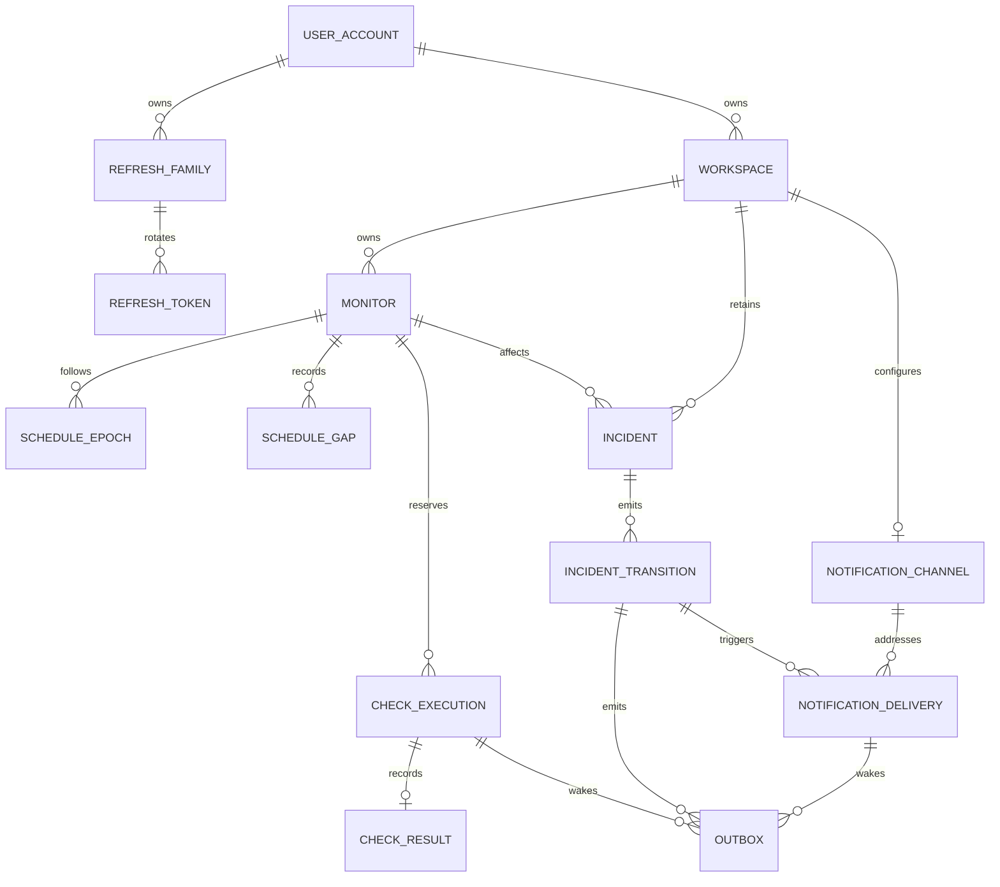

# Database Design

IP-005 · Stage 02 COMPLETED AND APPROVED · [AD-003](adr/adr-002-postgresql-history.md)

PostgreSQL owns users, workspace data, execution and delivery state. Public IDs are UUIDs; persist UTC instants as `timestamptz`. Use database time for leases, schedule and expiry. Record measured durations as bounded integer microseconds. The ERD shows logical relationships. Composite tenant constraints are spelled out below.

## Tables and constraints

Use non-null fields unless nullable by lifecycle. Workspace-bound tables carry `workspace_id`. The workspace owns all child data, with explicit ordered deletion as needed. Scoped relationships use composite FK targets with matching unique constraints on `(workspace_id, id)` or the full parent tuple below. Parent/subresource IDs are immutable. Columns and indexes are logical DDL inputs for Stage 04/05.

| Table | Identity and fields | Constraints and access paths |
|---|---|---|
| `installation_state` | Singleton key, initialized timestamp and bootstrap completion marker | Singleton row lock serializes setup. Registration policy is operator-managed configuration, disabled by default. |
| `user_account` | UUID, canonical email, password hash, created timestamp | Unique canonical email; password hash never serialized. |
| `refresh_family` | UUID, user ID, created timestamp, current generation, revoked timestamp/reason | FK to user, index by owner, row lock serializes refresh/logout. |
| `refresh_token` | Family ID, generation, token digest, issued/expires/consumed UTC times | PK `(family_id, generation)`, unique digest, retain spent evidence until at least token expiry. Expiry index for cleanup. |
| `workspace` | UUID, owner user ID, name, created/updated timestamps | FK to user. Index `(owner_user_id, id)`. MVP ownership has one role. |
| `monitor` | UUID, workspace ID, name, normalized target URL, method, interval, timeout, failure/recovery thresholds, state, version, schedule epoch, next due, last manual accepted, sequence counter and last applied sequence, failure/recovery streaks, created/updated/deleted timestamps | Partial due index `(next_check_at, id)` for live schedulable rows. Scoped list index. Checks for method, interval, timeout, positive thresholds and state. Tombstone preserves tenant identity. |
| `schedule_epoch` | Workspace and monitor IDs, epoch UUID, phase (ACTIVE/PAUSED), started/ended times, interval and first due while active | Scoped monitor FK, at most one current epoch, index by monitor and start. Epochs preserve pause intervals and explain expected cadence. |
| `schedule_gap` | Workspace and monitor IDs, epoch ID, first and last due, count, safe reason | Scoped epoch FK, unique start slot per epoch. Store compact missed/busy ranges; no outcome rows for these slots. |
| `check_execution` | UUID, workspace and monitor IDs, origin, status, scheduled slot (epoch and due, nullable for manual), configuration version, nullable requester user ID for manual work, per-monitor sequence, accepted/start/completion/ended timestamps, deadline, attempt count/token, lease expiry, network start marker, owning container/child incarnation and disposition code | Scoped monitor and optional slot epoch ownership. Use a scoped partial index on manual acceptance time to find the latest manual run and test recent manual reservation intervals. Unique per-monitor sequence and unique scheduled slot `(workspace_id, monitor_id, epoch_id, due_at)`. Partial unique active key `(workspace_id, monitor_id)` for QUEUED/RUNNING. Lease/deadline and terminal cleanup indexes. |
| `check_result` | Completion timestamp, execution/workspace/monitor IDs, outcome, origin, duration, nullable HTTP status, diagnostic code, metrics eligibility and stale reason | Time partitions and canonical-key integrity below. History and metrics index `(workspace_id, monitor_id, completed_at DESC, execution_id DESC)`. Workspace recent observations index `(workspace_id, completed_at DESC, execution_id DESC)`. |
| `incident` | UUID, workspace and monitor IDs, safe name snapshot and affected origin (scheme/host/port only), opened/closed UTC timestamps, close reason, nullable triggering execution UUID snapshots | Scoped monitor FK points to retained identity. Partial unique `(workspace_id, monitor_id)` for `closed_at IS NULL`. Index workspace/opened time/ID and support open-state filters; index monitor history. |
| `incident_transition` | UUID, workspace and incident IDs, kind, occurred timestamp | Scoped incident FK, unique kind per incident for OPENED and terminal closure, with close reason on incident. Trigger execution snapshots survive result retention. |
| `notification_channel` | UUID, workspace ID, provider, version, enabled state, event preferences, encrypted token/chat configuration and key ID, updated timestamp | Unique `(workspace_id, provider)`; require complete configured credentials when enabled. |
| `notification_delivery` | UUID, workspace, transition and channel IDs, channel version, recipient digest, status, attempt token/count, created/next attempt/start/lease/settlement times, safe failure and receipt references | Scoped transition and channel FKs, unique `(transition_id, recipient_digest)`. Index status/deadline and workspace/recent disposition. |
| `outbox` | UUID, workspace ID, nullable execution, transition or delivery reference, routing kind, wakeup generation, created/available/claimed/published times, claim token, attempt count and quarantine/disposition | Exactly one scoped ref and matching kind, unique job-ref/generation by kind using per-kind partial unique indexes. Index unpublished due rows and claim expiry. Delete old rows before purging referenced jobs. Prune settled transition publications independently of retained incidents after their diagnostic window. |

The only link from retained incidents to a purged execution is a UUID evidence snapshot. A monitor tombstone keeps only identity and safe lifecycle metadata. Clear target configuration and remove its checks, schedule epochs, gaps and check outbox rows on delete. Delete incident history on workspace deletion. Workspace names and notification settings are editable; ownership and installation policy are outside the editable schema.

## Result identity and partitioning

Range partition `check_result` by immutable `completed_at` in six-hour UTC buckets. Use parent PK `(completed_at, execution_id)`. A partitioned unique/primary key must include the partition key; a UUID-only result constraint would not work at this level. The unpartitioned execution table has UUID PK plus a unique constraint on `(workspace_id, monitor_id, id, completed_at)`. The result has a non-null FK with these four fields to that key (immediate, with deletion ordered results first). Set the canonical instant captured at check completion on the execution while holding its row lock, then insert the result in the same transaction. Disallow modification of a terminal execution's completion instant and identity through settlement logic. The FK excludes a result with another completion key or tenant, and the partitioned PK excludes duplicates for the valid key. There are no incoming FKs to partitions. Expose execution UUID as the result's public identifier.

Create partitions and local indexes ahead of time. Refuse a default partition. Missing partition coverage aborts settlement and produces an internal operational failure for reconciliation, with retries bounded and no replay of a started probe. The mandatory Stage 04 PostgreSQL DDL spike is pending. Verify FK and DDL behavior, prepared-plan partition pruning, query plans and locks for attach/detach under the pinned PostgreSQL version before storage implementation. Maintain filtered recent queries with explicit completion bounds.

## Retention and authorized removal

Stage 07 verifies result visibility and physical cleanup separately under [AC-036](../product/acceptance-criteria.md#ac-036).

- Use `completed_at > as_of - 30 days` and `completed_at <= as_of` for visible results. Expiry is at elapsed UTC time, independent of partition placement. Compact missed opportunities and pause intervals retain enough overlap to explain all reporting windows. Retain a live epoch reference and clip ranges at the read boundary.
- Once the upper partition bound is at least 30 days old, every row in that partition has expired. Run maintenance hourly, with a six-hour bucket imposing at most six hours of partition wait before maintenance. Budget the remaining time for cleanup, lock contention and recovery. Track oldest expired physical row and remaining deadline. Retry bounded partition DDL after lock timeout, and use bounded indexed deletes if drop is blocked. A prolonged outage requires operator recovery and may breach the deadline.
- Purge eligible terminal ledger and related wakeup rows after related results are gone, in small batches. Age unobserved terminal records by disposition time. Preserve pending/quarantined references while recoverable, bound terminal diagnostics and alert on growth. Historic replay with no authoritative job row is acknowledged without new effects.
- Monitor deletion serializes against start and settlement, tombstones the monitor, closes the incident and deletes scoped check history in one transaction. Delete dependent job/outbox rows in FK order. A concurrent publication can produce an inert wakeup after deletion. On large deletes, inspect query plans, lock duration and vacuum pressure. Authorized offline workspace deletion drains that workspace’s effects before scoped dependency removal and ends incident retention.

## Metrics and capacity

A metrics request uses one DB-sourced UTC `as_of`. Windows are `(as_of - duration, as_of]` by check completion for durations 24h, 7d and 30d. Use valid scheduled SUCCESS, FAILURE and TIMEOUT for uptime; TIMEOUT joins failures. Return counts for successful, failed, timeout, excluded by reason and known missed slots, with pause intervals and missing coverage separately. Distinguish active due slots with no known observation or disposition after their deadline from explicit gaps and from paused periods using epochs, progress and gap records. Calculate slot counts from each cadence epoch and clip gap ranges, using indexed scheduled execution keys for materialized slots. Bound the scan to the selected monitor and window. No eligible observations yields null uptime. Mean and exact discrete nearest-rank `ceil(p*n)` use successful scheduled response latency only, measured monotonically from the start of the approved numeric connect through completed response headers. Exclude queue time, DNS preparation and post-response storage from latency. Return null percentiles below 20 and 100 samples respectively. Use exact ordered SQL aggregation over one scoped monitor initially, with bounded requests. Measure before adopting persisted rollups, which must preserve exact ranks. Dashboard uses recent bounded reads and current monitor-state counts.

At 1,000 active monitors, theoretical arrival is 16.7/s at 60s and 33.3/s at 30s, yielding 43.2M and 86.4M potential 30-day results respectively. With six-hour buckets this is about 360k or 720k per full bucket and approximately 120 live partitions, plus ahead and cleanup headroom. Budget separately for the comparable execution ledger, indexes, write amplification, WAL, vacuum, backup and restore. Estimate disk from measured relation sizes per row multiplied by retained rows, then add observed WAL and maintenance headroom. Track pool waits and exact-metric sorts. At 1s mean service time Little's Law gives roughly 17/34 busy check slots before burst headroom. At the default 10s budget if every probe runs to deadline, those figures rise to about 167/334. Measure actual latency mix, queue/control capacity, drain time and aligned bursts. [Q-11](../product/prd.md#q-11) defines baseline targets and the stress profile; sizing is a planning input.
