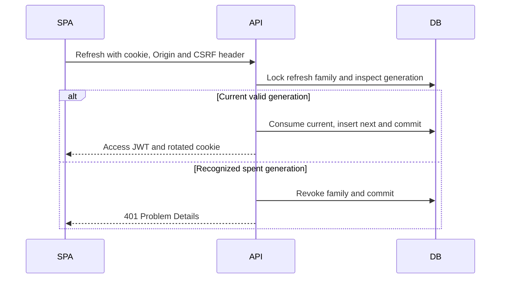

# Security Design

IP-005 · Stage 02 COMPLETED AND APPROVED · [AD-005](adr/adr-004-http-identity-and-spa.md) · [AD-010](adr/adr-005-outbound-and-deployment.md)

## Threat model

Trust boundaries separate the browser, reverse proxy, application, data plane, installation operator and external providers. Treat monitor inputs, DNS, all remote responses and task envelopes as untrusted. Trust the Linux host operator and the installation-managed policy/key material.

| Threat | Controls | Verification |
|---|---|---|
| Forged session, replay, CSRF or stolen credentials | Argon2id, signed short-lived JWT, opaque refresh rotation, origin validation, TLS and bounded auth attempts | Controlled token expiry, concurrent refresh, replay and hostile-origin fixtures |
| Tenant ID substitution | Join against current ownership; scoped FKs and worker revalidation | Two-workspace negative fixtures for reads, commands, task inputs and cursor reuse |
| SSRF and infrastructure reachability | URL policy, complete address-set validation, pinned connect, disabled alternate routes and network layer | [AC-051](../product/acceptance-criteria.md#ac-051), [AC-052](../product/acceptance-criteria.md#ac-052) actual destination evidence |
| Malicious response, scan or resource exhaustion | Bounded deadlines, headers, worker pools, rate budgets and sanitized diagnostics | Slow targets, burst tests, rate policies and known operational failure fixtures |
| Credential leakage through configs, logs or provider URLs | Scoped reads, write-only secrets, encrypted stored notification secrets and allowlisted log fields | [AC-053](../product/acceptance-criteria.md#ac-053) with synthetic secret markers |
| Broker tampering or replay | Per-service broker credentials, queue ACLs, strict envelope schemas, DB-scoped job reload and idempotent state transitions | Forged job and replay fixtures |
| Browser script injection | CSP, React escaping, no untrusted HTML, no third-party scripts, memory-only access token | Inspect headers and render controlled untrusted text |

## Identity and sessions

Bootstrap uses an operator-authorized local management command from the backend image, with a trusted terminal or secret input for the password. Operator deployment access authorizes this path. No public bootstrap route exists. Under the singleton DB lock, assert the installation is uninitialized, create an account and its first owned workspace, and mark initialization complete in one transaction. Repeat bootstrap is refused even if accounts are later removed. Signup is closed during bootstrap and disabled by default afterward. The operator changes the installation setting through managed configuration and applies it consistently to API replicas. Enabled signup creates an account and initial workspace atomically.

Login validates normalized email and password, uses generic credential errors and Argon2id with resource parameters validated on the reference host. JWTs carry user ID, session family ID, issuer, audience, issue and expiry timestamps and a token ID. Validate pinned algorithm, key ID against a local keyring, signature and all required claims. Clock skew is bounded. Issue 15-minute access JWTs, held in SPA memory. Each protected operation checks the active family and current user in PostgreSQL, which also gives logout and reuse detection immediate effect on subsequent authorization checks. Already authorized work may complete according to its business transaction.

The refresh credential is a high-entropy opaque token carried in a host-only HttpOnly cookie, with `Secure` in HTTPS, `SameSite=Strict` and `Path=/api/v1/auth`. Use seven-day expiry per issuance. Store a keyed digest and spent-generation evidence. Locating a valid digest and locking its family serialize refresh, logout and reuse handling. Rotating consumes the current generation and commits a new one, then sets the new cookie and returns the new access JWT. Invalid and expired credentials fail generically. Reuse of a recognized unexpired spent token revokes the entire family, including the newly issued generation, in the same transaction before returning 401. A concurrent second use is treated as reuse. A lost response after committed rotation can therefore require sign-in. Browser serialization is described in [Frontend design](frontend-design.md#authentication-and-cache-isolation).

Logout revokes the corresponding family using the presented recognized refresh cookie, clears the cookie with matching attributes and returns 204, including when there is no eligible session. Login, signup, refresh and logout require the configured exact Origin, JSON content type and a same-origin custom header, including empty refresh/logout bodies sent as `{}`. Requests with an absent or mismatched Origin are rejected. Nginx and the API use one configured public origin and deny cross-origin credentialed requests. Bearer-only routes do not accept the refresh cookie as authorization. Production requires HTTPS, HSTS after TLS provisioning and trusted forwarding only from Nginx. Use no-store for authenticated browser responses and token endpoints.

## Tenant enforcement

Build an explicit scope from validated user ID and current workspace ownership, even when a route starts at a monitor or incident ID. Apply tenant predicates to search, history, metrics and related-row reads. Use 404 for missing or foreign resources. A workspace UUID in a route, body or cursor grants no permission. Mutations lock or re-check the relevant scoped resources in their DB transaction. Background jobs rejoin workspace, monitor/execution or incident/channel/delivery by persisted scoped IDs before effects. For manual work compare the persisted requester ID with the current workspace owner before a network start. With immutable MVP ownership and live workspace validation, detached jobs are inert. PostgreSQL composites protect cross-tenant references. RLS is optional for MVP.

## Outbound policy and pinned transport

1. Canonicalize URLs under one strict HTTP(S) parser. Reject credentials, unsupported schemes, invalid host/port syntax, IPv6 zone IDs and ambiguous noncanonical numeric forms. Convert DNS names to their canonical ASCII form. Prevent header injection; build Host with the canonical name and nondefault port. Limit ports to 80/443 unless explicitly enabled by the operator. Save-time validation handles syntax and deterministic policy violations; runtime DNS and destination checks are mandatory.
2. Resolve exact A and AAAA answers through the installation's trusted resolver within the execution budget, without search suffixes. Incomplete, timed-out or inconclusive resolution fails closed. Normalize IPv4-mapped IPv6 before applying policy. Always deny loopback, link-local, metadata, unspecified, multicast, broadcast, reserved/non-routable classes and protected infrastructure addresses including host, management and control-plane service ranges. Explicitly classify eligible private/internal ranges and allow only operator-selected CIDRs with permitted ports. Denial takes precedence, and a mixed eligible/denied set is refused entirely. Apply the same policy to IP literals.
3. Select one verified numeric address. Use a custom synchronous HTTPX transport candidate that preserves the original URL authority for the HTTP layer and overrides the underlying TCP dial with the verified numeric socket address. The TLS layer uses the original DNS name as SNI and reference identity with mandatory trust-store and hostname verification. For IP literals verify an IP SAN, without relying on DNS SNI. Bind the connection to the chosen family and address, verify the effective peer with the socket before sending HTTP bytes, and abort on mismatch. Network enforcement also checks the actual routed destination after translation. Prove the behavior with the pinned HTTPX transport interfaces before use.
4. Disable redirect following, retries, fallback dialing, reconnects, HTTP/2 and cross-execution pooling for MVP probes. Open one disposable connection per execution. Set `trust_env=False` and no proxy or alternate transport mounts. Fix the resolver and trust configuration explicitly. Use bounded DNS preparation and a separate monotonic target deadline spanning connect, TLS, write and response headers. A hard task deadline covers both and settlement. Any later proposal to add a second connection path must repeat resolution, validation and numeric pinning under current policy and extend [AC-052](../product/acceptance-criteria.md#ac-052) evidence.
5. Apply versioned policy as an operator-controlled maintenance change. Drain and stop the affected outbound workers before changing routes or loading synchronized policy and firewall rules; block worker readiness until the active versions match. Worker startup refuses unrestricted fallback. Telegram uses a fixed verified HTTPS provider and distinct egress rules. The provider token never reaches the monitoring transport.

[AD-015](../project/decision-register.md#ad-015) requires [Linux host-managed enforcement](deployment-design.md#restricted-egress) alongside application-level destination verification. Compose networks determine attachment and reachability; a container attached to an egress network can normally route to destinations beyond its intended role. An internal bridge alone cannot enforce the destination classes or a port policy. Check workers have necessary PostgreSQL/RabbitMQ control-plane capabilities; these endpoints are always denied for monitor targets regardless of operator allowlists. Keep resolver and control-plane exceptions specific to their exact peers and service ports. Network policy limits reachability for a compromised process but those required capabilities remain within its trust boundary.

### Mandatory outbound spike

The mandatory Stage 04 [HTTPX transport](../development/technical-spikes.md#4-httpx-secure-transport) and [IPv4/IPv6 egress](../development/technical-spikes.md#5-ipv4ipv6-egress-enforcement) spikes passed on controlled testbeds. Run production-specific egress verification on Linux under [AD-013](../project/decision-register.md#ad-013). Observe original Host, DNS SNI, valid and invalid hostname/IP certificate paths and actual IPv4/IPv6 destinations. Cover direct IP, stable DNS, mixed and changing DNS, always-deny conflicts, mapped forms, control-plane/host addresses, allowed internal addresses and ignored environment proxy settings. Observe refusal or pinned safe behavior for a changed answer and a redirect without a subsequent connection. Verify there is no implicit reconnect, fallback or second socket. Exercise IPv6 routing, namespace loopback, bridge-to-host, gateway/resolver restrictions, destination translation and direct IP bypass. Identify every supported path as required by AC-052 and justify unavailable mechanisms. A failed or incomplete spike blocks monitoring engine implementation until a revised mechanism is agreed and proven.

## Rate limiting and secrets

Use atomic Redis token buckets with expiry and a trusted Nginx-derived client address. Apply all relevant buckets before executing side effects. Initial installation defaults are operational tuning inputs.

| Scope | Refill and burst |
|---|---|
| Public registration status per source | 60/minute, burst 20, combined with the public-auth aggregate. |
| Unauthenticated auth writes per source, plus per normalized login principal for sign-in | Per source 12/minute, burst 6. Per principal 6/minute, burst 3. |
| Authenticated API per user and per source | Per user 120/minute, burst 60. Per source 1,200/minute, burst 120. |
| Installation aggregate by lane | Public auth 120/minute, burst 30. Authenticated API 6,000/minute, burst 300. |
| Monitor configuration and manual requests per workspace | 60/minute, burst 15, in addition to the other applicable limits. |

Normalize IPv6 source buckets by prefix and prevent forged forwarding headers; define trusted proxy hops explicitly. Hash principal keys. Refresh and logout use their own aggregate lane (600/minute, burst 60) with a per-source 120/minute, burst 30 limit to isolate routine renewals. Reject excess with 429 and integer `Retry-After`. Redis failure returns bounded 503 on limited routes, while logout remains available through a smaller Nginx source limit and the durable family transaction. Independently enforce the exact accepted manual rate in PostgreSQL even across Redis eviction and restarts. Measure AC-054 with ordinary and abusive concurrent users. Validate runtime tuning against the approved 20-user reference traffic and NAT sharing.

Use mounted secret files and least-privilege service credentials. Encrypt Telegram credentials with authenticated encryption and an operator-held key ID, and mask values in API responses. Keep signing, encryption, refresh digest and cursor keys separate and provide a rotation and restore path. Never emit submitted URLs, query strings, auth/cookie headers, request bodies, raw provider responses or untrusted exception text in logs. Emit allowlisted codes, request/execution IDs, timing and disposition. Redact at application, edge and task logging boundaries. Keep sensitive configuration visible only to its authorized workspace owner where needed and credentials write-only.
