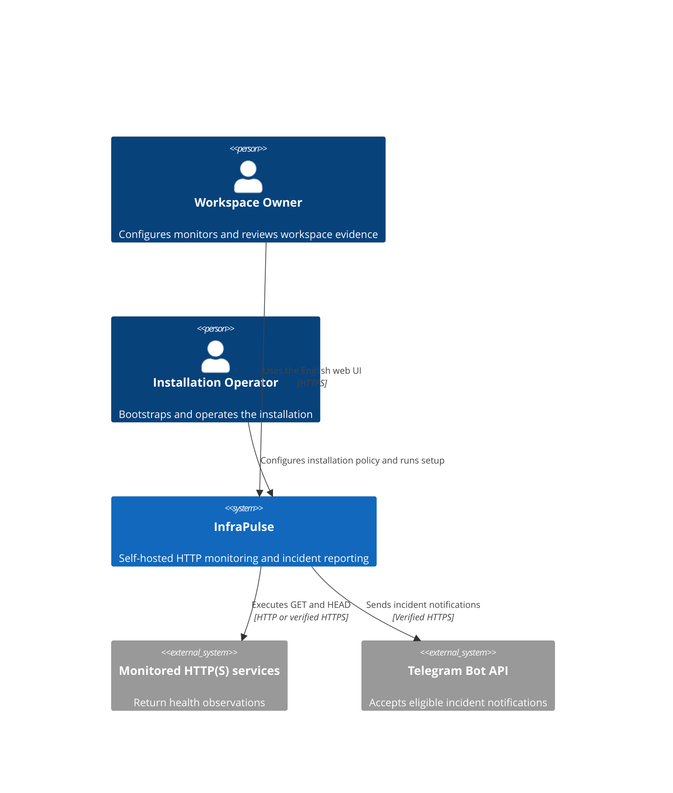
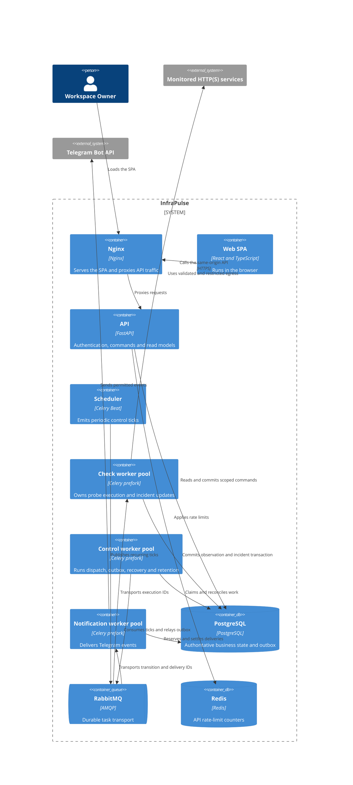
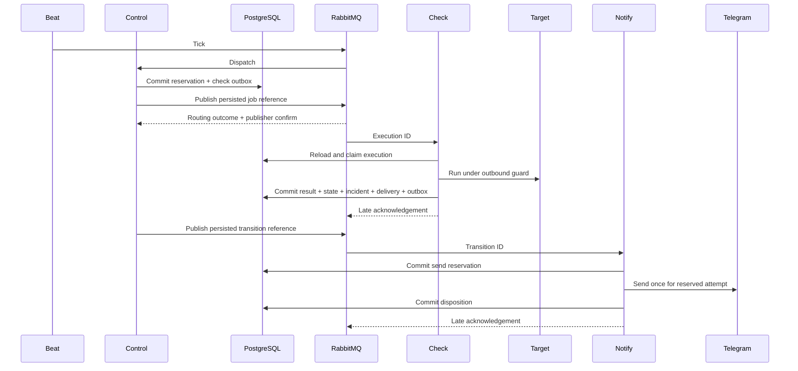

# System Architecture

IP-005 · Stage 02 COMPLETED AND APPROVED · MVP v0.1.0 design

The [decision register](../project/decision-register.md#approved-stage-02-architecture-decisions) records owner-approved AD-001–AD-016 and [PD-016](../project/decision-register.md#pd-016). Stage 03 is COMPLETED AND APPROVED under [IP-006 — UI/UX Design](../project/roadmap.md#ip-006-uiux-design). The [SRS](../product/srs.md), [business rules](../product/business-rules.md), [flows](../product/user-flows.md) and [acceptance criteria](../product/acceptance-criteria.md) govern behavior. This design covers MVP. Beta and v1.0.0 retain their [release assignments](../product/prd.md#feature-catalog).

## C4 level 1 · System context

## C4 level 2 · Containers

Beat and the control worker are separate processes from the shared image in a single scheduler container under [AD-016](../project/decision-register.md#ad-016). The [deployment design](deployment-design.md#scheduler-process-lifecycle) defines supervision and singleton ownership. Migration is a one-shot operator action. [Backend design](backend-design.md#module-boundaries) describes code-level ownership.

## Transaction and failure boundaries

| Boundary | Failure effect and recovery |
|---|---|
| Browser → API | Data already loaded can be marked stale. Current session and ownership are checked on every protected request. |
| API/control → PostgreSQL | A failed transaction leaves no reservation or partial lifecycle update. Broker or Telegram unavailability cannot roll back committed business state. |
| PostgreSQL → RabbitMQ | Confirm and outbox settlement are separate operations. Recovery can republish the same logical reference. |
| Check worker → target | Destination denial and platform faults do not advance failure streaks. Recovery requires proven local quiescence before another network attempt. |
| Notification worker → Telegram | A positive response or confirmed rejection has an evidence-based disposition. An ambiguous send settles UNKNOWN. |
| Redis → API | Throttled routes reject safely while the limiter is unavailable. Scheduler and worker processing continue independently. |

## Requirements and verification map

| Components | Requirements | Acceptance evidence |
|---|---|---|
| [Identity, tenant boundary](security-design.md) | [FR-001–FR-007](../product/srs.md#fr-001), [FR-009/010](../product/srs.md#fr-009), [NFR-001](../product/srs.md#nfr-001) | [AC-001–AC-007](../product/acceptance-criteria.md#ac-001), [AC-009–AC-011](../product/acceptance-criteria.md#ac-009) |
| [Monitor API, execution, incident engine](backend-design.md) | [FR-011–FR-037](../product/srs.md#fr-011), [NFR-002–NFR-006](../product/srs.md#nfr-002) | [AC-012–AC-043](../product/acceptance-criteria.md#ac-012), including [AC-042 for PD-016](../product/acceptance-criteria.md#ac-042) |
| [Telegram](backend-design.md#notification-engine) | [FR-038/039](../product/srs.md#fr-038), [FR-065](../product/srs.md#fr-065), [NFR-007](../product/srs.md#nfr-007) | [AC-044–AC-046](../product/acceptance-criteria.md#ac-044), [AC-097](../product/acceptance-criteria.md#ac-097) |
| [Dashboard, metrics and SPA](frontend-design.md) | [FR-040/041](../product/srs.md#fr-040), [FR-061–FR-064](../product/srs.md#fr-061), [NFR-027–NFR-031](../product/srs.md#nfr-027) | [AC-047/048](../product/acceptance-criteria.md#ac-047), [AC-083–AC-086](../product/acceptance-criteria.md#ac-083), [AC-091–AC-095](../product/acceptance-criteria.md#ac-091) |
| [Outbound and abuse controls](security-design.md) | [NFR-008–NFR-012](../product/srs.md#nfr-008) | [AC-050–AC-054](../product/acceptance-criteria.md#ac-050) |
| [Operations and setup](deployment-design.md) | [NFR-013–NFR-015](../product/srs.md#nfr-013), [NFR-023–NFR-026](../product/srs.md#nfr-023), [NFR-032/033](../product/srs.md#nfr-032) | [AC-055–AC-057](../product/acceptance-criteria.md#ac-055), [AC-087–AC-090](../product/acceptance-criteria.md#ac-087), [AC-096](../product/acceptance-criteria.md#ac-096), [AC-100](../product/acceptance-criteria.md#ac-100) |

The existing [requirements traceability matrix](../product/requirements-traceability-matrix.md) supplies feature, story, rule, flow and screen mappings.

## Verification gates

| Stage | Gate | Status | Evidence required |
|---|---|---|---|
| 02 | Owner review | COMPLETED AND APPROVED | IP-005 Final Acceptance approves the architecture documentation, [AD-013–AD-016](../project/decision-register.md#ad-013) and [PD-016](../project/decision-register.md#pd-016). |
| 04 | Stack compatibility | [PASS](../development/technical-spikes.md#1-technology-stack-compatibility) | Verify the [compatibility matrix and establish CI](technology-stack.md#stage-04-compatibility-verification). |
| 04 | PostgreSQL DDL | [PASS](../development/technical-spikes.md#2-postgresql-ddl-and-partitioning) | Verify [partition DDL, constraints, pruning and locks](database-design.md#result-identity-and-partitioning) on the pinned PostgreSQL version before storage implementation. |
| 04 | RabbitMQ semantics | [PASS](../development/technical-spikes.md#3-rabbitmq-delivery-semantics) | Verify [routing, confirms, late acknowledgements and bounded redelivery](backend-design.md#broker-semantics-spike) on the pinned stack before broker reliability implementation. |
| 04 | HTTPX transport | [PASS](../development/technical-spikes.md#4-httpx-secure-transport) | Verify the [pinned transport](security-design.md#mandatory-outbound-spike) before monitoring engine implementation. |
| 04 | IPv4/IPv6 egress | [PASS](../development/technical-spikes.md#5-ipv4ipv6-egress-enforcement) | Verify [Linux host-managed enforcement](security-design.md#mandatory-outbound-spike) before monitoring engine implementation. |
| 04 | Execution guard | [PASS](../development/technical-spikes.md#6-worker-execution-guard) | Verify [non-overlap and guarded recovery](backend-design.md#execution-guard-spike) before monitoring engine implementation. |
| 07 | Load and retention | PENDING | Complete the [load protocol](../product/srs.md#performance-measurement-protocol), measure the approved workload and verify [retention visibility and physical cleanup](../product/acceptance-criteria.md#ac-036) with controlled evidence. |
