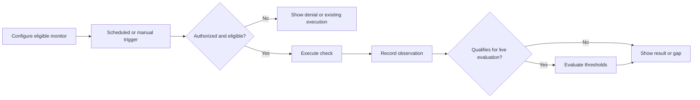

# InfraPulse User Flows and UI Screen Catalog

| Field | Value |
|---|---|
| Document Status | DRAFT — PENDING VALIDATION |
| Version | 0.1 |
| Responsible Role | Product Analyst |
| Related Project Stage | Stage 01 — Product Discovery |
| Project Task | IP-003 |
| Validation | IP-004, pending owner review |

## Flow conventions

Actors include users and automated participants. Screen references describe the proposed surface and omit detailed layouts. Behavior linked to open questions remains conditional.

### UF-001 — Initial Account Bootstrap

| Field | Flow |
|---|---|
| Actor | Installation Operator |
| Initial release | v0.1.0 MVP |
| Preconditions | Installation has no initial account |
| Trigger | Operator starts initial setup |
| Main success path | Authorize setup, establish the first account, then verify sign-in with public signup disabled. |
| Alternative paths | An existing initialized installation leads to sign-in. |
| Failure paths | Reject unauthorized or repeated bootstrap without creating an account. |
| Postconditions | First account can sign in and public signup follows installation policy. |
| Related requirements | [FR-001](srs.md#fr-001), [FR-002](srs.md#fr-002), [FR-003](srs.md#fr-003), [FR-004](srs.md#fr-004) |
| Related screens | [UI-001](#ui-001) |
| Validation note | Bootstrap entry surface is pending [Q-01](prd.md#q-01). |

### UF-002 — Registration

| Field | Flow |
|---|---|
| Actor | Visitor, Installation Operator |
| Initial release | v0.1.0 MVP |
| Preconditions | Initial setup is complete |
| Trigger | Operator changes policy or visitor opens signup |
| Main success path | Operator enables signup. Visitor completes valid signup. Operator can subsequently disable signup. |
| Alternative paths | With signup disabled, send existing users to sign-in. |
| Failure paths | Reject invalid details or a disabled registration safely. |
| Postconditions | Only eligible registration establishes an account. |
| Related requirements | [FR-003](srs.md#fr-003), [FR-004](srs.md#fr-004), [FR-005](srs.md#fr-005) |
| Related screens | [UI-001](#ui-001), [UI-002](#ui-002) |
| Validation note | Operator control surface is pending [Q-01](prd.md#q-01). |

### UF-003 — Sign In

| Field | Flow |
|---|---|
| Actor | Account holder |
| Initial release | v0.1.0 MVP |
| Preconditions | An account exists |
| Trigger | User opens sign-in |
| Main success path | Submit valid credentials, receive a JWT access token and a refresh token, and use the JWT to open the authorized workspace overview. |
| Alternative paths | An already signed-in user continues to their authorized view. |
| Failure paths | Invalid credentials issue no tokens. Missing, invalid or expired JWTs do not grant protected access. |
| Postconditions | An authenticated session is active. |
| Related requirements | [FR-005](srs.md#fr-005), [FR-009](srs.md#fr-009) |
| Related screens | [UI-001](#ui-001), [UI-003](#ui-003) |
| Validation note | Token and session parameters remain [Q-01](prd.md#q-01). |

### UF-004 — Session Refresh

| Field | Flow |
|---|---|
| Actor | Account holder via browser |
| Initial release | v0.1.0 MVP |
| Preconditions | An eligible session has a refresh token. |
| Trigger | The JWT access token expires. |
| Main success path | Present the valid refresh token, obtain a new JWT access token and use it to resume authorized access. |
| Alternative paths | An already valid session continues normally. |
| Failure paths | Missing, invalid or expired refresh tokens do not renew access. Failed renewal leads to sign-in without protected updates. |
| Postconditions | The authenticated user can continue or must sign in again. |
| Related requirements | [FR-006](srs.md#fr-006), [NFR-001](srs.md#nfr-001) |
| Related screens | [UI-001](#ui-001), [UI-003](#ui-003) |
| Validation note | Token and session parameters remain [Q-01](prd.md#q-01). |

### UF-005 — Sign Out

| Field | Flow |
|---|---|
| Actor | Account holder |
| Initial release | v0.1.0 MVP |
| Preconditions | Session is active |
| Trigger | User chooses sign out |
| Main success path | End the session and return to sign-in. |
| Alternative paths | An already ended session can return to sign-in. |
| Failure paths | A failed sign-out request must not display a confirmed success. |
| Postconditions | The refresh token valid before sign-out can no longer renew the ended session. |
| Related requirements | [FR-007](srs.md#fr-007) |
| Related screens | [UI-001](#ui-001), [UI-010](#ui-010) |
| Validation note | Session policy details remain [Q-01](prd.md#q-01). |

### UF-006 — Workspace Access

| Field | Flow |
|---|---|
| Actor | Workspace Owner |
| Initial release | v0.1.0 MVP |
| Preconditions | Owner has an established workspace |
| Trigger | User opens a workspace resource |
| Main success path | Authorize membership and show permitted resources. |
| Alternative paths | An empty workspace shows an empty overview. |
| Failure paths | Foreign and unauthenticated requests reveal no protected data. |
| Postconditions | Only the authorized workspace context is in view. |
| Related requirements | [FR-009](srs.md#fr-009), [NFR-001](srs.md#nfr-001), [FR-010](srs.md#fr-010) |
| Related screens | [UI-001](#ui-001), [UI-003](#ui-003), [UI-011](#ui-011) |
| Validation note | — |

### UF-007 — Monitor Creation

| Field | Flow |
|---|---|
| Actor | Workspace Owner |
| Initial release | v0.1.0 MVP |
| Preconditions | Workspace is accessible |
| Trigger | Owner selects create monitor |
| Main success path | Enter supported target and settings, validate and save. |
| Alternative paths | Use candidate defaults only once validated. |
| Failure paths | Reject bad methods, intervals, destinations or failed permission checks. |
| Postconditions | A valid monitor is visible and eligible for scheduling. |
| Related requirements | [FR-011](srs.md#fr-011), [FR-016](srs.md#fr-016), [FR-017](srs.md#fr-017), [FR-018](srs.md#fr-018), [FR-019](srs.md#fr-019), [FR-020](srs.md#fr-020), [FR-021](srs.md#fr-021), [FR-031](srs.md#fr-031), [NFR-008](srs.md#nfr-008), [NFR-009](srs.md#nfr-009), [NFR-010](srs.md#nfr-010) |
| Related screens | [UI-004](#ui-004), [UI-005](#ui-005), [UI-006](#ui-006) |
| Validation note | — |

### UF-008 — Monitor Editing

| Field | Flow |
|---|---|
| Actor | Workspace Owner |
| Initial release | v0.1.0 MVP |
| Preconditions | Monitor exists |
| Trigger | Owner selects edit |
| Main success path | Submit changed valid fields and review saved configuration. |
| Alternative paths | Cancel preserves saved configuration. |
| Failure paths | Invalid or unauthorized changes leave saved fields intact. |
| Postconditions | New configuration is shown. Transition details follow [Q-04](prd.md#q-04) after approval. |
| Related requirements | [FR-013](srs.md#fr-013), [FR-036](srs.md#fr-036), [FR-037](srs.md#fr-037), [NFR-008](srs.md#nfr-008), [NFR-009](srs.md#nfr-009), [NFR-010](srs.md#nfr-010), [NFR-031](srs.md#nfr-031) |
| Related screens | [UI-005](#ui-005), [UI-006](#ui-006) |
| Validation note | — |

### UF-009 — Monitor Deletion

| Field | Flow |
|---|---|
| Actor | Workspace Owner |
| Initial release | v0.1.0 MVP |
| Preconditions | Monitor exists |
| Trigger | Owner selects delete |
| Main success path | Delete the monitor and return to the list. |
| Alternative paths | Leave the monitor intact if the Owner abandons deletion. |
| Failure paths | A rejected deletion preserves the previous state. |
| Postconditions | Monitor is no longer actively managed. Existing incident and history treatment is [Q-04](prd.md#q-04). |
| Related requirements | [FR-014](srs.md#fr-014), [FR-036](srs.md#fr-036), [FR-037](srs.md#fr-037) |
| Related screens | [UI-004](#ui-004), [UI-006](#ui-006) |
| Validation note | — |

### UF-010 — Monitor Pause and Resume

| Field | Flow |
|---|---|
| Actor | Workspace Owner |
| Initial release | v0.1.0 MVP |
| Preconditions | An authorized monitor exists |
| Trigger | Owner pauses or resumes it |
| Main success path | Show the monitor as PAUSED. Scheduled opportunities arising during pause and jobs queued before pause cannot start a recurring target check while the monitor is paused. Resume restores eligibility for future scheduled checks. |
| Alternative paths | An open incident remains distinguishable under the proposed lifecycle. |
| Failure paths | A rejected change preserves the existing configuration and lifecycle. |
| Postconditions | Work suppressed during pause leaves no fabricated completed check or availability observation in history. |
| Related requirements | [FR-015](srs.md#fr-015), [FR-036](srs.md#fr-036), [FR-063](srs.md#fr-063) |
| Related screens | [UI-004](#ui-004), [UI-006](#ui-006) |
| Validation note | Paused manual checks in [UF-012](user-flows.md#uf-012) remain [Q-03](prd.md#q-03). Incident lifecycle details remain [Q-04](prd.md#q-04). |

### UF-011 — Scheduled Checks

| Field | Flow |
|---|---|
| Actor | Scheduler and worker |
| Initial release | v0.1.0 MVP |
| Preconditions | Active eligible monitor is due |
| Trigger | A configured check becomes due |
| Main success path | Execute approved work, record an outcome and evaluate eligible observations. |
| Alternative paths | Overlap and late outcomes enter their defined dispositions. |
| Failure paths | Worker unavailability and policy denial are identified separately from target failure. |
| Postconditions | History and live state reflect eligible evidence. |
| Related requirements | [FR-015](srs.md#fr-015), [FR-019](srs.md#fr-019), [FR-022](srs.md#fr-022), [NFR-002](srs.md#nfr-002), [NFR-003](srs.md#nfr-003), [NFR-004](srs.md#nfr-004), [FR-029](srs.md#fr-029), [FR-030](srs.md#fr-030), [FR-035](srs.md#fr-035), [FR-037](srs.md#fr-037), [NFR-010](srs.md#nfr-010), [NFR-032](srs.md#nfr-032) |
| Related screens | [UI-006](#ui-006) |
| Validation note | — |

### UF-012 — Manual Checks

| Field | Flow |
|---|---|
| Actor | Workspace Owner |
| Initial release | v0.1.0 MVP |
| Preconditions | Visible monitor and eligible requester |
| Trigger | Owner selects Run Check Now |
| Main success path | Authorize, check limits and overlap, accept background work, display progress and save result. |
| Alternative paths | Proposed collision behavior exposes existing work. |
| Failure paths | Throttled and unauthorized requests start no additional work. If the [Q-03](prd.md#q-03) pause proposal is approved, paused requests are rejected with an explanation. |
| Postconditions | History identifies the manual result and pending policy governs metric effects. |
| Related requirements | [FR-023](srs.md#fr-023), [FR-024](srs.md#fr-024), [FR-025](srs.md#fr-025), [NFR-005](srs.md#nfr-005), [FR-026](srs.md#fr-026), [FR-027](srs.md#fr-027), [FR-028](srs.md#fr-028), [FR-029](srs.md#fr-029) |
| Related screens | [UI-004](#ui-004), [UI-006](#ui-006) |
| Validation note | Paused manual eligibility and collision disposition remain [Q-03](prd.md#q-03). |

### UF-013 — Check History

| Field | Flow |
|---|---|
| Actor | Workspace Owner |
| Initial release | v0.1.0 MVP |
| Preconditions | Monitor history is authorized |
| Trigger | Owner opens history |
| Main success path | Review result, time, origin and available diagnostics. |
| Alternative paths | Display explicit empty history if there are no observations. |
| Failure paths | Denied access reveals no data. Refresh errors preserve indicated stale data. |
| Postconditions | Authorized results and exclusions are distinguishable. |
| Related requirements | [FR-024](srs.md#fr-024), [FR-030](srs.md#fr-030), [NFR-006](srs.md#nfr-006), [FR-035](srs.md#fr-035), [FR-041](srs.md#fr-041), [FR-063](srs.md#fr-063), [NFR-031](srs.md#nfr-031) |
| Related screens | [UI-006](#ui-006) |
| Validation note | — |

### UF-014 — Incident Detection

| Field | Flow |
|---|---|
| Actor | Worker and Workspace Owner |
| Initial release | v0.1.0 MVP |
| Preconditions | A monitor has no active incident |
| Trigger | Qualifying failure reaches threshold |
| Main success path | Open one incident and show its evidence. For a permitted opening event on an active, correctly configured Telegram channel, deliver to the configured recipient when the provider is available. |
| Alternative paths | Below-threshold and excluded outcomes do not open an incident. |
| Failure paths | Replay cannot create a second opening effect. |
| Postconditions | Incident is open and visible to the authorized user. |
| Related requirements | [NFR-004](srs.md#nfr-004), [FR-031](srs.md#fr-031), [FR-032](srs.md#fr-032), [FR-034](srs.md#fr-034), [FR-035](srs.md#fr-035), [FR-036](srs.md#fr-036), [FR-037](srs.md#fr-037), [FR-039](srs.md#fr-039), [FR-041](srs.md#fr-041) |
| Related screens | [UI-006](#ui-006), [UI-007](#ui-007), [UI-008](#ui-008) |
| Validation note | Default event preferences and delivery edges remain [Q-05](prd.md#q-05). |

### UF-015 — Incident Recovery

| Field | Flow |
|---|---|
| Actor | Worker and Workspace Owner |
| Initial release | v0.1.0 MVP |
| Preconditions | A monitor has an open incident |
| Trigger | Qualifying success reaches recovery threshold |
| Main success path | Close the incident as recovered and show closure evidence. For a permitted recovery event on an active, correctly configured Telegram channel, deliver to the configured recipient when the provider is available. |
| Alternative paths | An insufficient success streak leaves the incident open. |
| Failure paths | Internal fault and duplicate delivery do not create recovery. |
| Postconditions | Incident is recovered exactly once. |
| Related requirements | [NFR-004](srs.md#nfr-004), [FR-031](srs.md#fr-031), [FR-033](srs.md#fr-033), [FR-034](srs.md#fr-034), [FR-035](srs.md#fr-035), [FR-036](srs.md#fr-036), [FR-037](srs.md#fr-037), [FR-039](srs.md#fr-039), [FR-041](srs.md#fr-041) |
| Related screens | [UI-006](#ui-006), [UI-007](#ui-007), [UI-008](#ui-008) |
| Validation note | Default event preferences and delivery edges remain [Q-05](prd.md#q-05). |

### UF-016 — Telegram Notification Setup

| Field | Flow |
|---|---|
| Actor | Workspace Owner |
| Initial release | v0.1.0 MVP |
| Preconditions | Workspace settings are authorized |
| Trigger | Owner opens notifications |
| Main success path | Enter approved Telegram destination details, save, and inspect the masked configuration. |
| Alternative paths | Disable delivery when no longer wanted. |
| Failure paths | Reject invalid settings without exposing credentials. |
| Postconditions | A permitted transition can reach the configured recipient with an available provider. Disabling the channel stops new deliveries. |
| Related requirements | [FR-038](srs.md#fr-038), [FR-039](srs.md#fr-039), [NFR-007](srs.md#nfr-007), [NFR-011](srs.md#nfr-011), [FR-065](srs.md#fr-065) |
| Related screens | [UI-009](#ui-009) |
| Validation note | Default event preferences remain [Q-05](prd.md#q-05). |

### UF-017 — Notification Delivery Failures

| Field | Flow |
|---|---|
| Actor | Workspace Owner and worker |
| Initial release | v0.1.0 MVP |
| Preconditions | A transition notification is pending |
| Trigger | Provider reports a confirmed failure or the outcome remains indeterminate |
| Main success path | Show a confirmed failure as a delivery outcome and apply bounded retries where eligible under the validated policy. While open, Incident Details and Notification Settings refresh the displayed delivery data by polling. |
| Alternative paths | An eligible retry succeeds and becomes visible as delivered. |
| Failure paths | A permanent failure or exhausted retry budget leaves a visible failed disposition. |
| Postconditions | Incident remains unchanged by delivery outcome. |
| Related requirements | [NFR-004](srs.md#nfr-004), [FR-038](srs.md#fr-038), [FR-039](srs.md#fr-039), [NFR-007](srs.md#nfr-007), [NFR-011](srs.md#nfr-011), [NFR-032](srs.md#nfr-032), [FR-041](srs.md#fr-041) |
| Related screens | [UI-008](#ui-008), [UI-009](#ui-009) |
| Validation note | Retry eligibility and indeterminate provider outcomes remain [Q-05](prd.md#q-05). |

### UF-018 — Dashboard Usage

| Field | Flow |
|---|---|
| Actor | Workspace Owner |
| Initial release | v0.1.0 MVP |
| Preconditions | User is authenticated |
| Trigger | Owner opens overview |
| Main success path | Show initial loading, then authorized status and navigation. Open the monitors list and inspect the selected monitor's details and basic per-monitor metrics. Use browser-initiated polling for the open views in the [MVP polling scope](#mvp-polling-scope). Beta live views use Server-Sent Events. |
| Alternative paths | In Beta, open Analytics, change the supported window and eligible monitor selection, and compare the resulting availability and successful-check latency. Show combined metrics only if approved under [Q-06](prd.md#q-06). Empty observations remain explicit, and returning connectivity restores fresh values. |
| Failure paths | Keep any last confirmed data with a stale indicator on temporary update failure. |
| Postconditions | User can tell the data scope, freshness and next action. |
| Related requirements | [FR-040](srs.md#fr-040), [FR-041](srs.md#fr-041), [FR-042](srs.md#fr-042), [FR-061](srs.md#fr-061), [FR-062](srs.md#fr-062), [FR-063](srs.md#fr-063), [FR-064](srs.md#fr-064), [NFR-027](srs.md#nfr-027), [NFR-028](srs.md#nfr-028), [NFR-029](srs.md#nfr-029), [NFR-030](srs.md#nfr-030), [NFR-031](srs.md#nfr-031), [FR-012](srs.md#fr-012), [FR-052](srs.md#fr-052), [FR-066](srs.md#fr-066) |
| Related screens | [UI-003](#ui-003), [UI-004](#ui-004), [UI-006](#ui-006), [UI-007](#ui-007), [UI-012](#ui-012) |
| Validation note | UI-012 and cross-monitor comparison apply in Beta. Metric parameters and timing tolerances remain [Q-06](prd.md#q-06), [Q-12](prd.md#q-12). |

### UF-019 — Account Settings

| Field | Flow |
|---|---|
| Actor | Account holder |
| Initial release | v0.1.0 MVP |
| Preconditions | Session is valid |
| Trigger | User opens their settings |
| Main success path | View and change an approved own-account setting. |
| Alternative paths | Exit without changes. |
| Failure paths | Invalid values or foreign edits are rejected. |
| Postconditions | Only a validated own-account edit persists. |
| Related requirements | [FR-008](srs.md#fr-008), [NFR-029](srs.md#nfr-029), [NFR-031](srs.md#nfr-031) |
| Related screens | [UI-010](#ui-010) |
| Validation note | Editable fields are proposed in [Q-01](prd.md#q-01). |

### UF-020 — Workspace Settings

| Field | Flow |
|---|---|
| Actor | Workspace Owner |
| Initial release | v0.1.0 MVP |
| Preconditions | Owner is authorized |
| Trigger | Owner opens workspace settings |
| Main success path | Review scope and save an allowed workspace-level change. |
| Alternative paths | Access notifications from workspace navigation. |
| Failure paths | Cross-workspace and installation policy changes are denied. |
| Postconditions | Only permitted workspace settings change. |
| Related requirements | [FR-009](srs.md#fr-009), [NFR-001](srs.md#nfr-001), [FR-010](srs.md#fr-010), [FR-038](srs.md#fr-038), [NFR-009](srs.md#nfr-009) |
| Related screens | [UI-009](#ui-009), [UI-011](#ui-011) |
| Validation note | Editable fields are pending [Q-01](prd.md#q-01). |

### UF-021 — Beta Team Management

| Field | Flow |
|---|---|
| Actor | Owner, authorized Beta role, invitee |
| Initial release | v0.5.0 Beta |
| Preconditions | Workspace supports Beta roles |
| Trigger | An authorized actor manages an invitation or membership |
| Main success path | Issue invitation, verify invitee acceptance, assign an eligible role and remove access when needed. |
| Alternative paths | An invitation may be rejected. |
| Failure paths | Invalid invitations and unauthorized role changes grant no access. |
| Postconditions | Membership and access reflect authorized actions. |
| Related requirements | [FR-048](srs.md#fr-048), [FR-049](srs.md#fr-049), [FR-050](srs.md#fr-050), [FR-051](srs.md#fr-051) |
| Related screens | [UI-015](#ui-015) |
| Validation note | Role matrix and lifecycle details are [Q-07](prd.md#q-07). |

### UF-022 — Beta API Key Management

| Field | Flow |
|---|---|
| Actor | Authorized workspace user |
| Initial release | v0.5.0 Beta |
| Preconditions | Beta API access is enabled |
| Trigger | Actor opens API keys |
| Main success path | Create a scoped key, use it in scope and revoke it when no longer required. |
| Alternative paths | Keep an existing key when abandoning revocation. |
| Failure paths | Out-of-scope and revoked keys are denied. |
| Postconditions | Only current authorized credentials permit scoped operations. |
| Related requirements | [NFR-001](srs.md#nfr-001), [NFR-011](srs.md#nfr-011), [FR-055](srs.md#fr-055) |
| Related screens | [UI-016](#ui-016) |
| Validation note | Key lifecycle details are [Q-15](prd.md#q-15). |

### UF-023 — Beta Status Pages

| Field | Flow |
|---|---|
| Actor | Authorized workspace user, public visitor |
| Initial release | v0.5.0 Beta |
| Preconditions | Workspace has eligible monitors |
| Trigger | Actor configures a public page |
| Main success path | Select monitors, publish and verify anonymous display. |
| Alternative paths | Keep a page private before publication. |
| Failure paths | Reject unauthorized publication and conceal unselected resources. |
| Postconditions | Intended information is available publicly. |
| Related requirements | [NFR-001](srs.md#nfr-001), [FR-053](srs.md#fr-053) |
| Related screens | [UI-013](#ui-013), [UI-014](#ui-014) |
| Validation note | Public field set is [Q-15](prd.md#q-15). |

### UF-024 — Beta Maintenance Windows

| Field | Flow |
|---|---|
| Actor | Authorized workspace user |
| Initial release | v0.5.0 Beta |
| Preconditions | Eligible monitors exist |
| Trigger | Actor creates a maintenance window |
| Main success path | Choose eligible monitors and a valid time range, save and inspect its current phase. |
| Alternative paths | An upcoming window remains visible before it begins. |
| Failure paths | Invalid time range or unauthorized monitor is rejected. |
| Postconditions | Window timing and scope are visible. Metric effects require validation. |
| Related requirements | [FR-054](srs.md#fr-054) |
| Related screens | [UI-017](#ui-017) |
| Validation note | Temporal, incident and metric effects remain [Q-15](prd.md#q-15). |

### UF-025 — Interactive Demo Usage

| Field | Flow |
|---|---|
| Actor | Public demo visitor |
| Initial release | v1.0.0 Release |
| Preconditions | Isolated public demo is available |
| Trigger | Visitor enters a fresh demo session |
| Main success path | Give the visitor an isolated demo session. The visitor takes a permitted action that causes a controlled synthetic monitoring scenario to execute or change. The visitor sees the resulting outcome through an existing product surface in that session. |
| Alternative paths | Simulated notification outcomes are a proposed option under [Q-13](prd.md#q-13). |
| Failure paths | Reject arbitrary targets, real destinations, foreign sessions and over-limit use. |
| Postconditions | The action affects only the acting session and uses only controlled synthetic targets. Verify cleanup separately under the approved lifecycle policy in [AC-077](acceptance-criteria.md#ac-077). |
| Related requirements | [FR-058](srs.md#fr-058), [NFR-017](srs.md#nfr-017), [NFR-018](srs.md#nfr-018), [NFR-019](srs.md#nfr-019) |
| Related screens | [UI-003](#ui-003), [UI-004](#ui-004), [UI-006](#ui-006), [UI-008](#ui-008) |
| Validation note | The screens above are reuse candidates. The action, scenario, entry and reset surfaces remain [Q-13](prd.md#q-13). |

### UF-026 — Beta Additional Monitor Types

| Field | Flow |
|---|---|
| Actor | Authorized workspace user |
| Initial release | v0.5.0 Beta |
| Preconditions | Beta monitoring and approved test targets are available |
| Trigger | Actor creates a supported non-basic monitor |
| Main success path | Select TCP, certificate, keyword or JSON, validate inputs and inspect the result. |
| Alternative paths | Changing an eligible condition affects later evaluations. |
| Failure paths | Reject invalid input and forbidden destinations without outbound access. |
| Postconditions | Monitor history shows authorized typed outcomes. |
| Related requirements | [FR-043](srs.md#fr-043), [FR-044](srs.md#fr-044), [FR-045](srs.md#fr-045), [FR-059](srs.md#fr-059), [FR-060](srs.md#fr-060), [NFR-022](srs.md#nfr-022) |
| Related screens | [UI-005](#ui-005), [UI-006](#ui-006) |
| Validation note | Beta extends the MVP monitor surfaces. Malformed JSON classification is conditional on [Q-09](prd.md#q-09). |

### UF-027 — Beta Notification Channels

| Field | Flow |
|---|---|
| Actor | Authorized workspace user |
| Initial release | v0.5.0 Beta |
| Preconditions | Beta notification integrations are available |
| Trigger | Actor opens notification settings |
| Main success path | Configure approved email or webhook delivery and observe a controlled delivery. |
| Alternative paths | Keep Telegram in use where configured. |
| Failure paths | Reject blocked destinations and report sanitized provider failures. |
| Postconditions | Valid destination receives eligible transitions. |
| Related requirements | [NFR-007](srs.md#nfr-007), [NFR-011](srs.md#nfr-011), [FR-046](srs.md#fr-046), [FR-047](srs.md#fr-047) |
| Related screens | [UI-009](#ui-009) |
| Validation note | Beta extends the MVP settings surface. |

### UF-028 — Release Audit Log

| Field | Flow |
|---|---|
| Actor | Authorized workspace user |
| Initial release | v1.0.0 Release |
| Preconditions | Release audit evidence exists |
| Trigger | Actor opens audit log |
| Main success path | Review approved own-workspace actor, action and time evidence. |
| Alternative paths | Show an explicit empty log when appropriate. |
| Failure paths | Foreign scope and secret values are unavailable. |
| Postconditions | User can identify covered workspace actions. |
| Related requirements | [NFR-001](srs.md#nfr-001), [NFR-011](srs.md#nfr-011), [FR-056](srs.md#fr-056) |
| Related screens | [UI-018](#ui-018) |
| Validation note | Audit event list is [Q-15](prd.md#q-15). |

### UF-029 — Release Reports

| Field | Flow |
|---|---|
| Actor | Authorized workspace user |
| Initial release | v1.0.0 Release |
| Preconditions | Release report feature is available |
| Trigger | Actor requests an export |
| Main success path | Select authorized scope and download the report. |
| Alternative paths | An empty selection shows no data under the validated format. |
| Failure paths | Reject unauthorized report scope. |
| Postconditions | Export reflects only approved selected data. |
| Related requirements | [NFR-001](srs.md#nfr-001), [FR-057](srs.md#fr-057) |
| Related screens | [UI-019](#ui-019) |
| Validation note | Export details are [Q-15](prd.md#q-15). |

## UI Screen Catalog

All screens are **PROPOSED** surface descriptions. The product-wide Dark Only requirement applies to every screen. Earlier screens can receive later-release capability extensions. Screen layout and breakpoints are pending Stage 03.

| ID | Title | Purpose | Actions | Initial release | Requirements | Flows |
|---|---|---|---|---|---|---|
|  UI-001 | Sign In | Start or resume account access | Submit credentials and continue to workspace | v0.1.0 MVP | [FR-005](srs.md#fr-005), [FR-006](srs.md#fr-006), [FR-007](srs.md#fr-007), [NFR-027](srs.md#nfr-027), [NFR-028](srs.md#nfr-028), [NFR-029](srs.md#nfr-029), [NFR-030](srs.md#nfr-030) | [UF-001](#uf-001), [UF-002](#uf-002), [UF-003](#uf-003), [UF-004](#uf-004), [UF-005](#uf-005), [UF-006](#uf-006) |
|  UI-002 | Sign Up | Join when public registration is enabled | Provide registration details and proceed to sign-in | v0.1.0 MVP | [FR-003](srs.md#fr-003), [FR-004](srs.md#fr-004), [FR-005](srs.md#fr-005), [NFR-027](srs.md#nfr-027), [NFR-028](srs.md#nfr-028), [NFR-029](srs.md#nfr-029), [NFR-030](srs.md#nfr-030) | [UF-002](#uf-002) |
|  UI-003 | Overview Dashboard | Review the workspace and data freshness | Inspect current states and navigate to detail views | v0.1.0 MVP | [FR-009](srs.md#fr-009), [FR-040](srs.md#fr-040), [FR-041](srs.md#fr-041), [FR-042](srs.md#fr-042), [FR-063](srs.md#fr-063), [NFR-027](srs.md#nfr-027), [NFR-028](srs.md#nfr-028), [NFR-029](srs.md#nfr-029), [NFR-030](srs.md#nfr-030), [NFR-031](srs.md#nfr-031), [FR-058](srs.md#fr-058) | [UF-003](#uf-003), [UF-004](#uf-004), [UF-006](#uf-006), [UF-018](#uf-018), [UF-025](#uf-025) |
|  UI-004 | Monitors List | Find and manage monitors | Browse current monitor and manual execution state, add, edit, pause, resume and request eligible manual checks | v0.1.0 MVP | [FR-011](srs.md#fr-011), [FR-012](srs.md#fr-012), [FR-014](srs.md#fr-014), [FR-015](srs.md#fr-015), [FR-023](srs.md#fr-023), [FR-025](srs.md#fr-025), [NFR-027](srs.md#nfr-027), [NFR-028](srs.md#nfr-028), [NFR-029](srs.md#nfr-029), [NFR-030](srs.md#nfr-030), [NFR-031](srs.md#nfr-031), [FR-058](srs.md#fr-058), [FR-041](srs.md#fr-041) | [UF-007](#uf-007), [UF-009](#uf-009), [UF-010](#uf-010), [UF-012](#uf-012), [UF-018](#uf-018), [UF-025](#uf-025) |
|  UI-005 | Create / Edit Monitor | Configure a monitoring target | Select supported type, edit settings, validate and save | v0.1.0 MVP | [FR-011](srs.md#fr-011), [FR-013](srs.md#fr-013), [FR-016](srs.md#fr-016), [FR-017](srs.md#fr-017), [FR-018](srs.md#fr-018), [FR-019](srs.md#fr-019), [FR-020](srs.md#fr-020), [FR-021](srs.md#fr-021), [FR-031](srs.md#fr-031), [NFR-008](srs.md#nfr-008), [NFR-009](srs.md#nfr-009), [NFR-010](srs.md#nfr-010), [FR-043](srs.md#fr-043), [FR-044](srs.md#fr-044), [FR-045](srs.md#fr-045), [FR-059](srs.md#fr-059), [FR-060](srs.md#fr-060), [NFR-022](srs.md#nfr-022), [NFR-027](srs.md#nfr-027), [NFR-028](srs.md#nfr-028), [NFR-029](srs.md#nfr-029), [NFR-030](srs.md#nfr-030), [NFR-031](srs.md#nfr-031) | [UF-007](#uf-007), [UF-008](#uf-008), [UF-026](#uf-026) |
|  UI-006 | Monitor Details | Investigate an individual monitor | View configuration, results, metrics and manual execution state | v0.1.0 MVP | [FR-012](srs.md#fr-012), [FR-013](srs.md#fr-013), [FR-015](srs.md#fr-015), [FR-023](srs.md#fr-023), [FR-024](srs.md#fr-024), [FR-025](srs.md#fr-025), [NFR-005](srs.md#nfr-005), [FR-026](srs.md#fr-026), [FR-027](srs.md#fr-027), [FR-028](srs.md#fr-028), [FR-029](srs.md#fr-029), [FR-030](srs.md#fr-030), [FR-035](srs.md#fr-035), [FR-041](srs.md#fr-041), [FR-061](srs.md#fr-061), [FR-062](srs.md#fr-062), [FR-063](srs.md#fr-063), [FR-064](srs.md#fr-064), [NFR-027](srs.md#nfr-027), [NFR-028](srs.md#nfr-028), [NFR-029](srs.md#nfr-029), [NFR-030](srs.md#nfr-030), [NFR-031](srs.md#nfr-031), [FR-058](srs.md#fr-058) | [UF-007](#uf-007), [UF-008](#uf-008), [UF-009](#uf-009), [UF-010](#uf-010), [UF-011](#uf-011), [UF-012](#uf-012), [UF-013](#uf-013), [UF-014](#uf-014), [UF-015](#uf-015), [UF-018](#uf-018), [UF-025](#uf-025), [UF-026](#uf-026) |
|  UI-007 | Incidents List | Review incident activity | Find active and recovered incidents | v0.1.0 MVP | [FR-034](srs.md#fr-034), [FR-041](srs.md#fr-041), [NFR-027](srs.md#nfr-027), [NFR-028](srs.md#nfr-028), [NFR-029](srs.md#nfr-029), [NFR-030](srs.md#nfr-030), [NFR-031](srs.md#nfr-031) | [UF-014](#uf-014), [UF-015](#uf-015), [UF-018](#uf-018) |
|  UI-008 | Incident Details | Inspect incident evidence | Review affected monitor, timestamps and delivery disposition | v0.1.0 MVP | [FR-032](srs.md#fr-032), [FR-033](srs.md#fr-033), [FR-034](srs.md#fr-034), [FR-039](srs.md#fr-039), [NFR-007](srs.md#nfr-007), [NFR-027](srs.md#nfr-027), [NFR-028](srs.md#nfr-028), [NFR-029](srs.md#nfr-029), [NFR-030](srs.md#nfr-030), [NFR-031](srs.md#nfr-031), [FR-058](srs.md#fr-058), [FR-041](srs.md#fr-041) | [UF-014](#uf-014), [UF-015](#uf-015), [UF-017](#uf-017), [UF-025](#uf-025) |
|  UI-009 | Notification Settings | Configure eligible notification destinations | Save masked settings, disable delivery and inspect failures | v0.1.0 MVP | [FR-038](srs.md#fr-038), [NFR-007](srs.md#nfr-007), [NFR-011](srs.md#nfr-011), [FR-046](srs.md#fr-046), [FR-047](srs.md#fr-047), [NFR-027](srs.md#nfr-027), [NFR-028](srs.md#nfr-028), [NFR-029](srs.md#nfr-029), [NFR-030](srs.md#nfr-030), [FR-041](srs.md#fr-041) | [UF-016](#uf-016), [UF-017](#uf-017), [UF-020](#uf-020), [UF-027](#uf-027) |
|  UI-010 | Account Settings | Manage own account and session | Inspect approved account fields and sign out | v0.1.0 MVP | [FR-007](srs.md#fr-007), [FR-008](srs.md#fr-008), [NFR-027](srs.md#nfr-027), [NFR-028](srs.md#nfr-028), [NFR-029](srs.md#nfr-029), [NFR-030](srs.md#nfr-030), [NFR-031](srs.md#nfr-031) | [UF-005](#uf-005), [UF-019](#uf-019) |
|  UI-011 | Workspace Settings | Manage scoped settings | Review and save allowed workspace settings | v0.1.0 MVP | [FR-009](srs.md#fr-009), [NFR-001](srs.md#nfr-001), [FR-010](srs.md#fr-010), [NFR-027](srs.md#nfr-027), [NFR-028](srs.md#nfr-028), [NFR-029](srs.md#nfr-029), [NFR-030](srs.md#nfr-030) | [UF-006](#uf-006), [UF-020](#uf-020) |
|  UI-012 | Analytics | Explore extended monitoring metrics | Filter times and eligible monitors | v0.5.0 Beta | [FR-042](srs.md#fr-042), [FR-052](srs.md#fr-052), [FR-061](srs.md#fr-061), [FR-062](srs.md#fr-062), [FR-063](srs.md#fr-063), [FR-066](srs.md#fr-066), [NFR-027](srs.md#nfr-027), [NFR-028](srs.md#nfr-028), [NFR-030](srs.md#nfr-030) | [UF-018](#uf-018) |
|  UI-013 | Status Pages | Manage publication | Select monitors and publish eligible status content | v0.5.0 Beta | [FR-053](srs.md#fr-053), [NFR-027](srs.md#nfr-027), [NFR-028](srs.md#nfr-028), [NFR-030](srs.md#nfr-030) | [UF-023](#uf-023) |
|  UI-014 | Public Status Page | Communicate selected service status | View published state without authentication | v0.5.0 Beta | [FR-053](srs.md#fr-053), [NFR-027](srs.md#nfr-027), [NFR-028](srs.md#nfr-028), [NFR-030](srs.md#nfr-030) | [UF-023](#uf-023) |
|  UI-015 | Team Management | Administer participants | Invite, assign validated roles and remove access | v0.5.0 Beta | [FR-048](srs.md#fr-048), [FR-049](srs.md#fr-049), [FR-050](srs.md#fr-050), [FR-051](srs.md#fr-051), [NFR-027](srs.md#nfr-027), [NFR-028](srs.md#nfr-028), [NFR-030](srs.md#nfr-030) | [UF-021](#uf-021) |
|  UI-016 | API Keys | Manage scoped automation access | Create and revoke keys | v0.5.0 Beta | [FR-055](srs.md#fr-055), [NFR-027](srs.md#nfr-027), [NFR-028](srs.md#nfr-028), [NFR-030](srs.md#nfr-030) | [UF-022](#uf-022) |
|  UI-017 | Maintenance Windows | Plan maintenance | Schedule and inspect windows | v0.5.0 Beta | [FR-054](srs.md#fr-054), [NFR-027](srs.md#nfr-027), [NFR-028](srs.md#nfr-028), [NFR-030](srs.md#nfr-030) | [UF-024](#uf-024) |
|  UI-018 | Audit Log | Inspect workspace activity | Review covered actor, action and time records | v1.0.0 Release | [FR-056](srs.md#fr-056), [NFR-027](srs.md#nfr-027), [NFR-028](srs.md#nfr-028), [NFR-030](srs.md#nfr-030) | [UF-028](#uf-028) |
|  UI-019 | Reports | Export monitoring evidence | Select scope and request report export | v1.0.0 Release | [FR-057](srs.md#fr-057), [NFR-027](srs.md#nfr-027), [NFR-028](srs.md#nfr-028), [NFR-030](srs.md#nfr-030) | [UF-029](#uf-029) |

### Pending screen coverage

- Initial setup and operator policy controls have no dedicated registered screen. Propose an operator-controlled setup and administration entry, with sign-in as the existing handoff. [Q-01](prd.md#q-01), [Q-10](prd.md#q-10).
- Demo entry, expiry feedback and reset have no dedicated registered screen. Propose reuse for interactive views and an approved entry/reset affordance. [Q-13](prd.md#q-13).
- Operational telemetry uses the approved external Grafana surface for installation operators. It does not require a proposed InfraPulse screen.

## MVP polling scope

[FR-041](srs.md#fr-041) and [AC-048](acceptance-criteria.md#ac-048) apply to the following operational data while the corresponding screen is open.

| Screen | Changing operational data |
|---|---|
| [UI-003](#ui-003) | Monitor states, recent observations and incident summaries |
| [UI-004](#ui-004) | Listed monitor states and manual execution state |
| [UI-006](#ui-006) | Check history, manual execution progress and basic per-monitor metrics |
| [UI-007](#ui-007) | Active and recovered incident list |
| [UI-008](#ui-008) | Incident disposition and notification delivery disposition |
| [UI-009](#ui-009) | Notification delivery failures visible in settings |

[UI-001](#ui-001) and [UI-002](#ui-002) handle authentication and registration. [UI-005](#ui-005), [UI-010](#ui-010) and [UI-011](#ui-011) handle configuration, account and workspace settings. These screens have no documented changing monitoring or delivery data. Polling cadence and freshness tolerances remain open under [Q-12](prd.md#q-12).

## References

- [Product Requirements Document](prd.md)
- [Software Requirements Specification](srs.md)
- [User Stories](user-stories.md)
- [Business Rules](business-rules.md)
- [Acceptance Criteria](acceptance-criteria.md)
